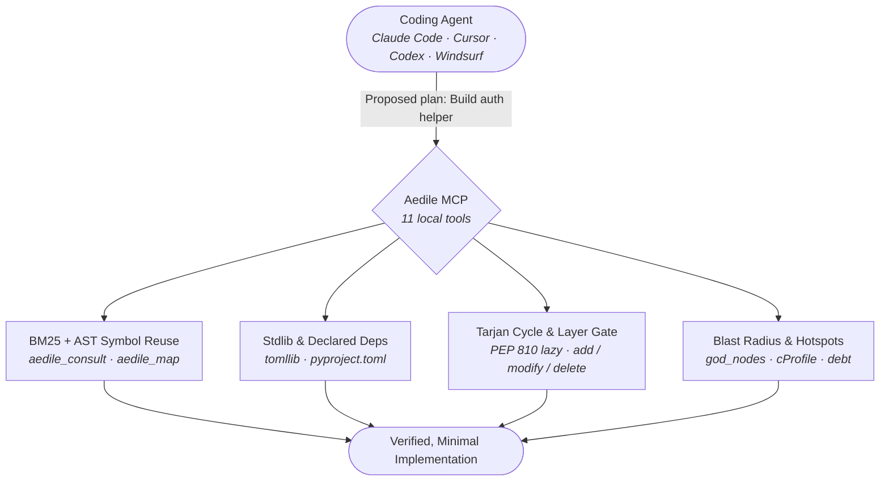

<p align="center">
  
</p>

<h1 align="center">Aedile</h1>

<p align="center">
  <strong>Before an AI writes code, it should prove that the code deserves to exist.</strong>
</p>

<p align="center">
  <a href="https://github.com/aaryanrwt/aedile/actions/workflows/ci.yml">
    
  </a>
  <a href="https://pypi.org/project/aedile/">
    
  </a>
  <a href="https://pypi.org/project/aedile/">
    
  </a>
  <a href="https://www.python.org/">
    
  </a>
  <a href="https://github.com/astral-sh/ruff">
    
  </a>
  <a href="https://mypy-lang.org/">
    
  </a>
  <a href="LICENSE">
    
  </a>
</p>

<p align="center">
Aedile is a zero-dependency engineering intelligence layer for AI coding assistants. Before a single line of code is written, it parses your repository into an AST and Tarjan dependency graph—surfacing existing helpers, preferring the standard library, blocking circular imports and layer violations, and keeping generated diffs minimal on your own machine.
</p>

---



---

## Why Aedile?

Modern coding assistants know how to write code. They usually don't know your architecture.

Static prompt rules drift as the context window fills, and regex-only maps miss nested definitions, import graphs, and layer boundaries. That leads to:

- duplicated utilities (15–30 lines rewritten when 1–5 lines would reuse existing code)
- unnecessary third-party dependencies
- circular imports and broken layer boundaries
- dangling imports when modules are deleted

Aedile verifies the repository deterministically before code is generated, giving coding assistants real AST and graph facts instead of relying on prompts alone.

---

## Quick Example

**Without Aedile**

```text
AI: "I'll write a custom TOML dependency parser and a new cache class."
↓
Repository already has tomllib and ScanCache.
↓
29 lines of duplicated code.
```

**With Aedile**

```text
Aedile [Observed: AST/Graph]:
  "Reuse ScanCache in src/aedile/infrastructure/cache.py and stdlib tomllib."
  "ARCHITECTURAL VIOLATION: importing cli from shared violates layer order."
↓
AI reuses existing abstractions in 9 lines with zero violations.
```

---

## Install & Setup

```bash
pip install aedile
```

Configure MCP servers and `SessionStart` / `SubagentStart` hooks automatically (creates `.aedile.bak` backups):

```bash
aedile setup
```

Check your environment, toolchain, and agent registrations:

```bash
aedile doctor
```

See [SUPPORTED_AGENTS.md](SUPPORTED_AGENTS.md) for manual Claude Code, Cursor, Windsurf, Copilot, and Gemini CLI setup.

---

## Commands & MCP Tools

| CLI Command | MCP Tool | What it does |
|---|---|---|
| `aedile` | `aedile_consult` | Consult reuse, stdlib, declared deps, and pre-edit verification |
| — | `aedile_verify_architecture` | Simulate `add` / `modify` / `delete` changes before writing files |
| `aedile map` | `aedile_map` | Emit token-budgeted AST symbol & layer map |
| `aedile graph` | `aedile_graph` | Export Mermaid, SVG, GraphML, or Cypher graphs + blast radius |
| `aedile explain <mod>` | `aedile_explain` | Inspect a module's imports, dependents, instability, and blast radius |
| `aedile path <a> <b>` | `aedile_path` | Shortest dependency path with `EXTRACTED` / `LAZY` hop provenance |
| `aedile insights` | `aedile_insights` | Surface `god_nodes`, subsystem communities, bridges, and questions |
| `aedile review` | `aedile_review` | Caller-aware diff review ranked Must / Should / Nice to have |
| `aedile audit` | `aedile_audit` | Whole-repo ranked audit combining rules, hubs, and debt |
| `aedile debt` | `aedile_debt` | Harvest `# shortcut:` / `# aedile-waive:` debt ledger |
| `aedile hotspots <py>` | `aedile_hotspots` | `cProfile` hotspot ranker with `covered_by` outermost-caller detection |
| `aedile check` | — | CI gate (`text`, `json`, `sarif`, `html`, `card`) with `--baseline` |
| `aedile mode` / `board` / `doctor` | — | Intensity modes (`lite\|full\|ultra\|off`), local telemetry board, and diagnostics |

---

## Benchmarks (Real Measured Runs)

All benchmarks were executed locally with zero fabricated numbers:

1. **10-Task Bloat & LOC Test (`qwen3:4b`)** — [BLOAT_LOC_BENCHMARK.md](benchmarks/BLOAT_LOC_BENCHMARK.md):
   - Avg generated code dropped from **19.6 LOC** (Without Aedile) to **9.9 LOC** (With Aedile, **-49.5% less code**).
   - Codebase / stdlib reuse rose from **2/10 (20%)** to **10/10 (100%)**.
2. **12-Prompt Reuse & Architecture Suite (`qwen3:4b`)** — [BENCHMARKS.md](benchmarks/BENCHMARKS.md):
   - Aedile vs. Ponytail (`AGENTS.md` + `ponytail-map.js`): **10/12 (83.3%)** vs. **2/12 (16.7%)** LLM hit rate, **11/12 (91.7%)** vs. **0/12** deterministic tool catches, and lower avg prompt tokens (**752.8** vs. **794.6**).
3. **10 Production Repositories (50k+ Stars Each)** — [MEGA_10_REPO_VALIDATION.md](benchmarks/MEGA_10_REPO_VALIDATION.md):
   - Validated across `fastapi`, `flask`, `requests`, `yt-dlp`, `django`, `express`, `vite`, `nest`, `gin`, and `ripgrep` (**2,674** files, **5,367** edges): **915/923 (99.1%)** checks passed.
4. **Core Test Suite**: **1,072** passing tests in `pytest` (`Python 3.15.2`, `ruff` + `mypy` strict clean).

---

## FAQ

**Does Aedile require internet access or API keys?**
No. All AST parsing, graph simulation, profiling, caching, and telemetry stay 100% local.

**Which languages and Python versions are supported?**
Python `3.13–3.15` (including PEP 810 `lazy import` cycle awareness) via stdlib `ast`, plus zero-dependency structural parsers for TypeScript, JavaScript, Go, and Rust.

**How do I adopt Aedile on an existing repo without fixing old violations first?**
Run `aedile check --update-baseline`, then gate CI with `aedile check --baseline` so only *new* regressions fail the build.

---

## Documentation

- [Architecture](docs/ARCHITECTURE.md)
- [Decision Ladder](docs/DECISION_LADDER.md)
- [Competitor Comparison](docs/COMPETITORS.md)
- [FAQ](docs/FAQ.md)
- [Supported Agents](SUPPORTED_AGENTS.md)
- [Roadmap](ROADMAP.md)
- [REA Research Analyses](docs/research/REA_ANALYSIS_GRAPHIFY.md)
- [Changelog](CHANGELOG.md)
- [Security Policy](SECURITY.md)

---

## Contributing & License

Contributions are welcome. See [CONTRIBUTING.md](CONTRIBUTING.md) and [CODE_OF_CONDUCT.md](CODE_OF_CONDUCT.md).

Aedile is released under the [MIT License](LICENSE).

---

## Star History

<a href="https://www.star-history.com/#aaryanrwt/aedile&Date">
  <picture>
    <source media="(prefers-color-scheme: dark)" srcset="https://api.star-history.com/svg?repos=aaryanrwt/aedile&type=Date&theme=dark" />
    <source media="(prefers-color-scheme: light)" srcset="https://api.star-history.com/svg?repos=aaryanrwt/aedile&type=Date" />
    
  </picture>
</a>
